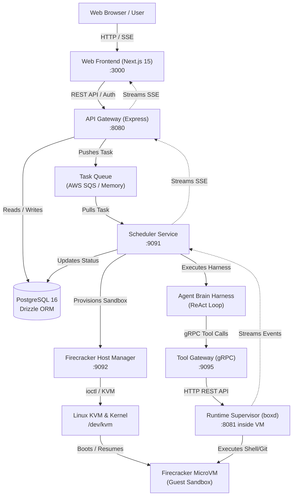

# Diagram 1: System Overview & Component Topology

---

### Component Breakdown & Explanation

This diagram captures the complete end-to-end topology of Devin. The web frontend interacts with an Express API gateway, backed by PostgreSQL and an SQS task queue. The Scheduler coordinates tasks, commanding the Firecracker Host Manager to spin up dedicated MicroVMs via Linux KVM while launching the Brain reasoning harness. The Brain issues gRPC tool calls through a Go Tool Gateway, which routes HTTP commands to the in-guest supervisor daemon (`boxd`). Event updates and terminal outputs stream back to the browser via Server-Sent Events.

---

### What to Say While Showing This

- *"At a high level, Devin splits cleanly into two realms: the Control Plane, where the agent thinks, and the Execution Plane, where code actually runs."*
- *"When a user types a prompt in the browser, the API server enqueues the job and the scheduler picks it up."*
- *"Notice the isolation seam: the Brain never executes code directly. It talks through a gRPC Tool Gateway to an in-guest supervisor daemon running inside a hardware-isolated Firecracker MicroVM."*
- *"All output streams back through SSE so the user watches terminal logs, diffs, and desktop activity with zero polling."*
