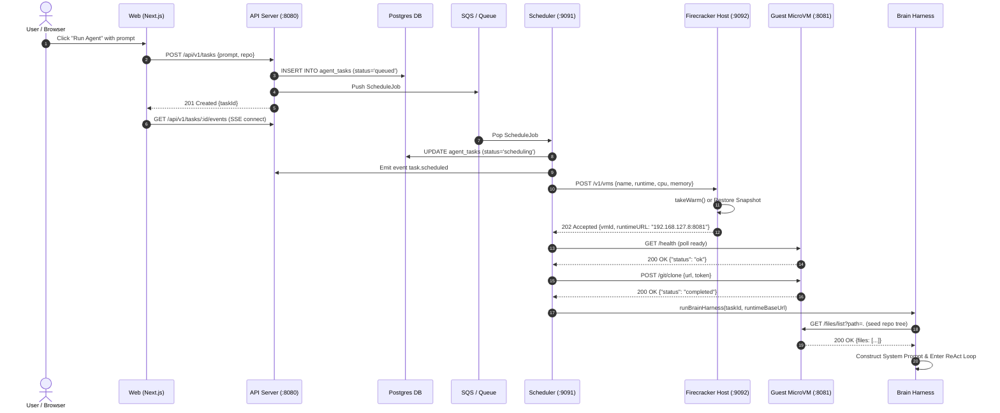

# Diagram 2: Task Lifecycle Sequence (Flow A)

---

### Step-by-Step Sequence Explanation

A detailed sequence trace of Flow A, following the exact route from the user clicking "Run Agent" to the first LLM reasoning turn. It highlights asynchronous queueing, database status transitions (`queued` -> `scheduling` -> `sandbox_starting` -> `running`), warm-pool assignment from the Firecracker daemon, guest health checking, repo cloning, and initial filesystem tree seeding to prevent hallucination.

---

### What to Say While Showing This

- *"Let's follow the lifecycle of a task from the moment you hit submit."*
- *"The server writes the task to Postgres and pushes it to an SQS queue. This prevents traffic spikes from crushing the execution hosts."*
- *"The scheduler asks the Firecracker host for a sandbox. If a warm VM is ready, assignment takes less than 30 milliseconds."*
- *"Before the LLM generates a single token, Devin runs a shallow git clone inside the sandbox and seeds the real file tree into the prompt. That simple trick stops the model from hallucinating file paths."*
