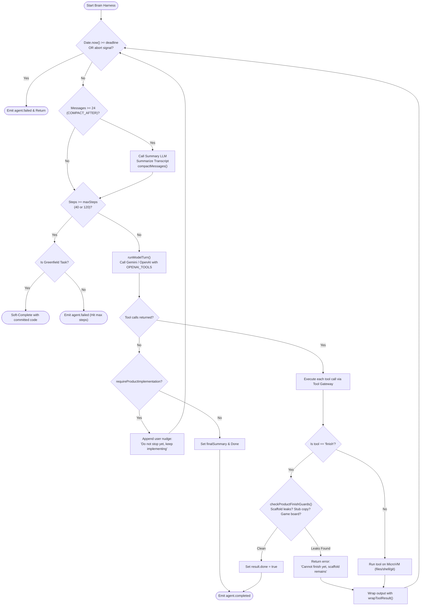

# Diagram 3: Autonomous Agent ReAct Loop & Safety Guards

---

### Loop Mechanics & Safety Gates Explanation

This flowchart details the inner workings of `apps/brain/src/harness/src/loop.ts`. It illustrates the ReAct cycle, the deadline checks, conversation compaction triggered at 24 messages, model execution with Google Gemini 3.8 Flash or OpenAI models, product implementation finish guards, and the difference between hard failure and greenfield soft completion.

---

### What to Say While Showing This

- *"Inside the Brain, we run an autonomous ReAct loop — Reasoning plus Acting."*
- *"Every turn checks two critical fuses: a wall-clock deadline and a step budget. If the task exceeds 40 steps, or 120 steps on a fresh project, the loop halts."*
- *"Notice the compaction block: at 24 messages, context fills up. Devin calls a secondary LLM to summarize past turns into durable facts, discarding verbose outputs while preserving instructions."*
- *"Look closely at the finish gate: if an agent builds a greenfield app and tries to finish while template scaffold text (`'Scaffold ready'`, `'Coming soon'`) remains, the finish guard rejects the tool call and forces the model to keep implementing."*
