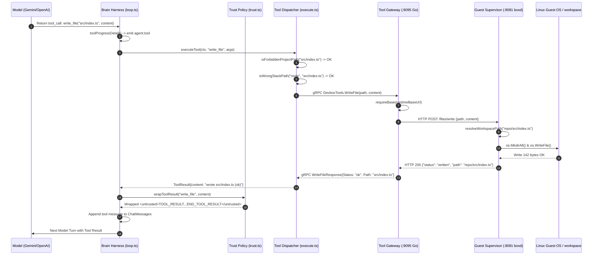

# Diagram 4: Tool Execution Protocol & gRPC Bridge (Flow B)

---

### Protocol & Translation Explanation

This sequence diagram visualizes Flow B: how an abstract model tool call (e.g. `write_file`) travels across the system boundary to become a concrete filesystem change inside the guest MicroVM, returning untrusted data wrapped in security tags.

---

### What to Say While Showing This

- *"When the model outputs a structured JSON tool call, here is how it actually executes."*
- *"First, Brain runs path security checks: it blocks edits to `node_modules`, `.next`, or `.git`."*
- *"Brain sends a gRPC call to the Tool Gateway. The Gateway translates this into an HTTP POST over the host TAP bridge into the MicroVM's supervisor on port 8081."*
- *"The guest daemon writes the file, returns status, and Brain wraps the response in `<untrusted>` tags before feeding it back to the model. This guarantees tool output is treated as data, not prompt injection instructions."*
