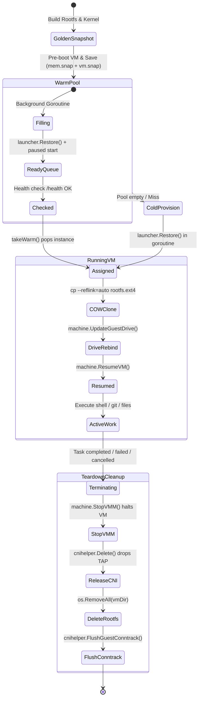

# Diagram 5: Firecracker MicroVM Lifecycle & Warm Pools

---

### State Transitions & Pool Management Explanation

A state machine showing how golden rootfs images and snapshot states (`mem.snap` and `vm.snap`) are generated, kept in a pre-booted warm pool, cloned via copy-on-write reflinks upon assignment, actively managed during task execution, and cleanly dismantled during teardown.

---

### What to Say While Showing This

- *"Firecracker MicroVMs boot cold in about 1 second, but Devin takes this further with snapshotting."*
- *"We pre-boot a VM, let it configure its network, and take a memory snapshot. In the background, the manager holds a warm pool of pre-restored VMs."*
- *"When a task arrives, we clone the golden root filesystem using XFS reflink pointers — copy-on-write takes roughly 28 milliseconds with zero disk duplication."*
- *"When the session ends, the VMM process terminates, the TAP device is torn down, the cloned disk is wiped, and conntrack tables are flushed."*
