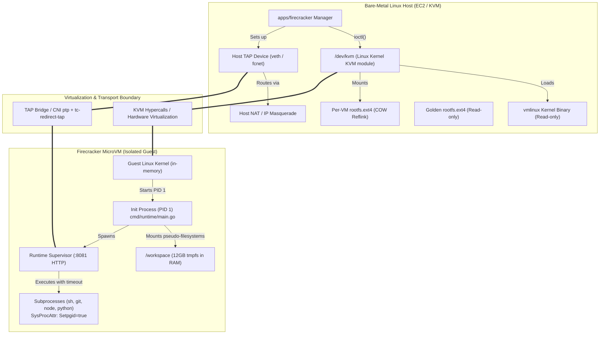

# Diagram 6: The Virtualization Boundary (Host vs. Guest)

---

### Hardware Boundary & Isolation Mechanics Explanation

An architectural breakdown of the virtualization boundary separating the bare-metal Linux host from the guest sandbox. It details the roles of the host KVM kernel module, uncompressed `vmlinux` binary, copy-on-write `rootfs.ext4`, the PID 1 `devin-runtime-supervisor` init process, and the 12 GB in-memory `tmpfs` workspace.

---

### What to Say While Showing This

- *"Here is what makes MicroVMs different from Docker containers."*
- *"In Docker, the container shares the host kernel. If a malicious script triggers a kernel exploit, it can compromise the entire host."*
- *"In Devin, each sandbox runs its own dedicated Linux kernel binary via `/dev/kvm`. Even if a user command gets root inside the guest, it is trapped inside its own hardware-isolated memory space."*
- *"Inside the guest, our custom Go binary is PID 1. It mounts a 12-gigabyte tmpfs in RAM for lightning-fast builds without thrashing host disks."*
