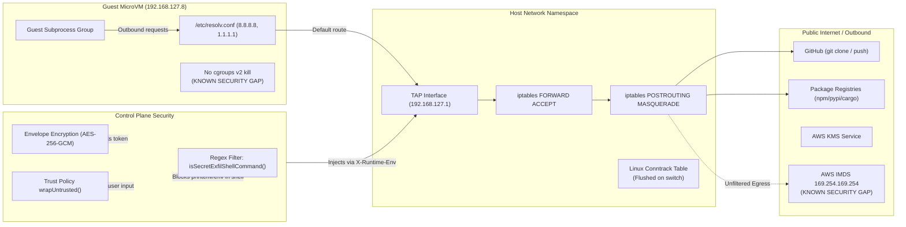

# Diagram 7: Sandboxed Networking & Security Boundaries

---

### Network Architecture & Threat Model Explanation

A detailed topology of network isolation, host iptables NAT rules, CNI configuration, envelope encryption for tokens via AWS KMS, prompt exfiltration blockers, and explicit callouts of known security gaps (lack of cgroups v2 kill and unprotected AWS IMDS endpoint).

---

### What to Say While Showing This

- *"Networking in Devin balances internet access for package managers with tenant isolation."*
- *"The guest connects through a TAP interface bridged via CNI plugins with iptables NAT masquerading."*
- *"OAuth tokens are encrypted using AES-256-GCM envelope encryption with AWS KMS. The plaintext token is only passed to git operations inside the sandbox via ephemeral headers."*
- *"Here are two crucial gaps you must understand: currently, the guest lacks cgroups v2 process grouping, so orphan fork bombs are possible. Additionally, outbound HTTP does not block AWS IMDS at 169.254.169.254 — a critical hardening step before multi-tenant production."*
