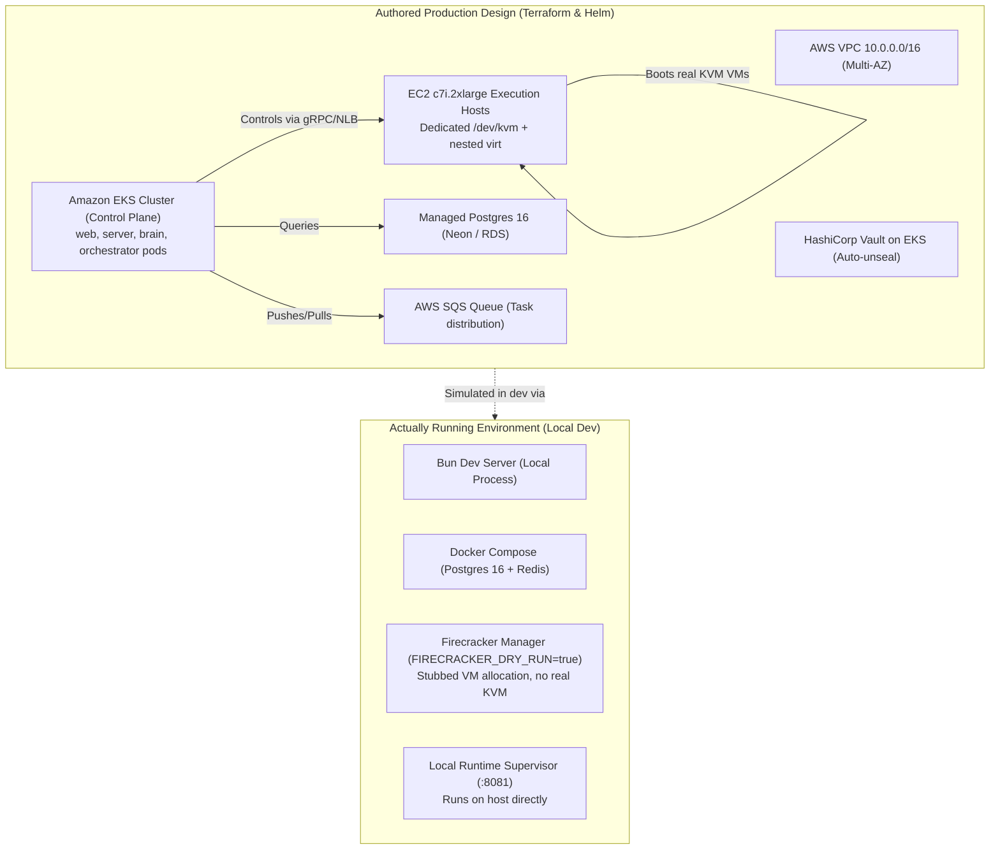

# Diagram 9: Production Infrastructure vs. Local Development

---

### Cloud Architecture vs. Development Emulation Explanation

A structural comparison contrasting the written production Terraform / Kubernetes architecture (EKS control plane, bare-metal C7i EC2 execution hosts, HashiCorp Vault, AWS SQS) against the local development environment (`FIRECRACKER_DRY_RUN=true`, local Bun processes, Docker Compose Postgres).

---

### What to Say While Showing This

- *"Let's talk about deployment reality versus development."*
- *"The codebase includes full Terraform for an AWS EKS control plane coupled with bare-metal EC2 C7i instances that support nested KVM virtualization."*
- *"However, for day-to-day development without expensive bare-metal AWS servers, the Firecracker daemon has a dry-run flag. In dry-run mode, it stubs out VM allocations and routes commands to a local supervisor process on your machine."*
