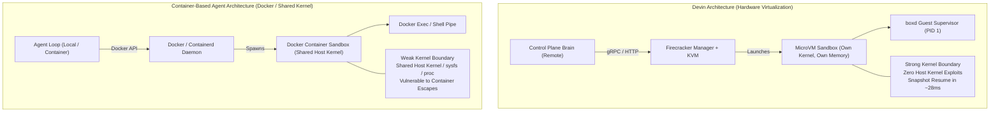

# Diagram 10: Devin vs. Container-Based Agent Architectures

---

### Architectural Contrast & Isolation Models Explanation

A side-by-side structural comparison contrasting Devin's MicroVM architecture (hardware virtualization, independent kernels, COW rootfs clones, remote Brain) against the common container-based agent pattern (Docker daemon, shared host kernel, docker exec pipes).

---

### What to Say While Showing This

- *"To wrap up our architecture review, let's contrast Devin with container-based agent architectures."*
- *"In a container-based system like Sonofanton or standard Docker agents, you spin up Docker containers. While lightweight, they share the host kernel, access `/proc` and `/sys`, and cannot safely execute untrusted kernel modules or root-level system edits."*
- *"Devin's Firecracker approach gives each agent its own genuine virtual machine with dedicated kernel and memory. You get the isolation of a full cloud VM with the sub-second speed of a container."*
